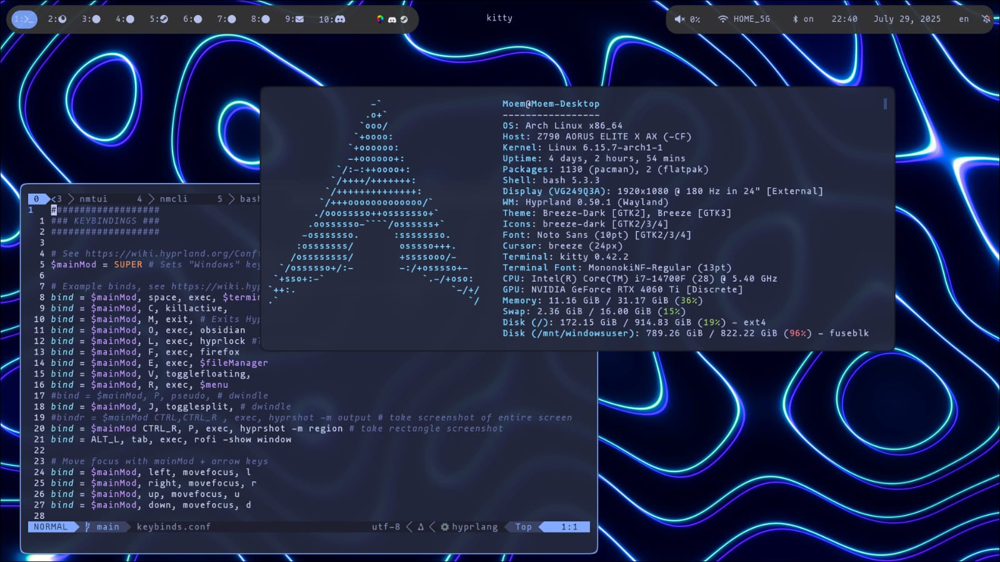

# My Personal Arch Linux / Hyprland dotfiles
- Distro : Arch Linux
- Window Manager : Hyprland
- Code / Text Editor : NeoVim
- Terminal : kitty
- File Manager : yazi
- Status Bar : waybar
- Other : tmux, starship, rofi

---

## To-Do:
- [] Rewrite NeoVim config 
- [] Replace waybar
- [] Refactor / cleanup all dotfiles

- [] Write a new device setup script
- [] Custom ISO

